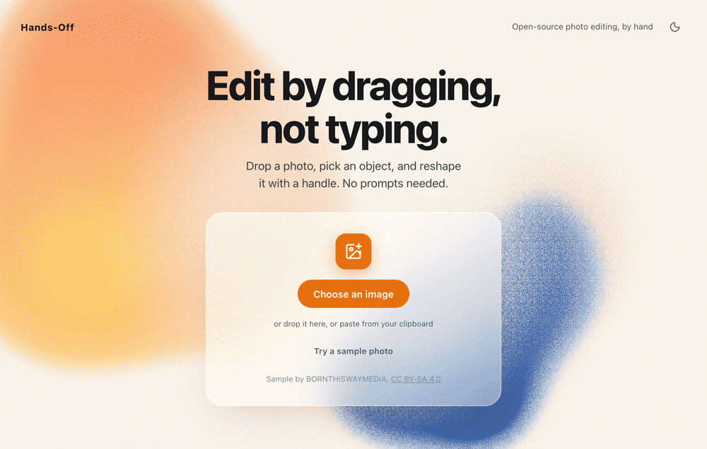

<div align="center">

# Project Hands Off

**Edit photos by dragging, not typing.**

An open-source alternative to Adobe's *Project Hands On*. Click an object, grab a handle, drag it where you
want it, and an AI image model makes it look real. Self-host it, and use any model on OpenRouter.



[Quick start](#quick-start) · [How it works](#how-it-works) · [Choose your models](#use-any-model-on-openrouter) · [Docs](docs/README.md) · [Contributing](CONTRIBUTING.md)

</div>

---

## Why it exists

Prompting an image editor is a guessing game: you describe a change in words, wait, and hope. Adobe's
*Project Hands On* showed a better way at MAX Sneaks 2026: put the controls **on the object itself**. Shorten a
couch by dragging its end. Reshape a perfume bottle by pulling its corners. No prompt to write, and you see
exactly what you asked for before anything is generated.

Hands-Off brings that idea to everyone, as free software you run yourself.

## What you can do

- **Point at things.** Hover a photo and every object lights up. Click one.
- **Get controls that fit.** Hands-Off looks at the object and offers the changes that make sense for it
  ("couch length", "armrest shape", "bottle height"), each with the right kind of control.
- **Drag.** A slider stretches an object, corner points reshape it, handles move its parts. It all happens
  instantly in your browser, with no waiting and no network.
- **Press Apply.** An image model turns your rough edit into a photoreal result. Only the area you changed is
  touched; every other pixel stays exactly as it was.
- **Compare, then keep it.** Slide between before and after. Accept it as a new version, retry, or discard.
  Undo and redo, a version history with a plain-English summary of each change, and saved projects come with it.

## How it works

```
 your photo ─► find objects ─► suggest edits ─► you drag a control ─► generate ─► blend back in
               (runs locally)   (a vision model)  (instant, in browser)  (an image model)  (only where you edited)
```

1. **Detection runs on your machine.** An open RF-DETR-Seg model finds objects and their outlines in about half
   a second on a laptop CPU.
2. **A vision model proposes the controls.** It looks at the object and decides what is worth changing and
   where the handles belong, with strict validation and sensible fallbacks so the editor never dead-ends.
3. **Dragging is local.** Your edit is drawn on the canvas immediately.
4. **An image model does the pixels.** It gets your photo and a picture of what you drew, and is told to make it
   look like a real photograph. The result is colour-matched and blended back in, so nothing outside your edit changes.

## Use any model on OpenRouter

Hands-Off talks to AI models only through [OpenRouter](https://openrouter.ai), so you pick what runs each step,
and can change your mind at any time in **Settings**. No code changes, no redeploy.

| Step | What it does | Default |
|---|---|---|
| Suggest | Looks at an object and proposes what can be changed | `deepseek/deepseek-v4.1-flash` |
| Place controls | Decides where the control goes | `deepseek/deepseek-v4.1-flash` |
| Summarise | Writes the change log | `deepseek/deepseek-v4.1-flash` |
| Generate | Makes the edited image | `google/gemini-3-pro-image` (about $0.14 an edit) |

Want it cheaper or faster? Try `google/gemini-3.1-flash-image` or a lighter model. Anything
OpenRouter lists works, and a fallback model is tried if your first choice fails. See [docs/models.md](docs/models.md).

You bring your own OpenRouter key. It stays on your server, is never sent to the browser, and is never logged.
No key yet? Start with `HANDS_OFF_DEMO_AI=1` to try the whole editor with built-in rules.

## Quick start

You need [Docker](https://docs.docker.com/get-docker/) and an [OpenRouter key](https://openrouter.ai/keys).

```sh
git clone https://github.com/abbasmithaiwala/project-hands-off.git
cd project-hands-off
cp .env.example .env          # put your OPENROUTER_API_KEY in it (or paste it in the app later)
docker compose up --build
```

Open **<http://localhost:8080>**, drop in a photo (or try the sample), click an object, and drag.

> **First start:** the detection model (about 130 MB) is downloaded once and kept in the `hands-off-data` volume.
> Released images know where to get it. If you build from source, point `HANDS_OFF_RFDETR_SEG_URL` at a hosted copy,
> or export it yourself with `just models` and mount it. See [docs/deployment.md](docs/deployment.md).

Other ways to run it:

- **Release binary** (Linux and macOS): download an archive from the releases page, then
  `HANDS_OFF_WEB_DIR=./web ./hands-off`. Checksums and signatures are published with each release.
- **From source:** see [CONTRIBUTING.md](CONTRIBUTING.md).

## Self-hosting

One process, one data directory, no database server. Your photos never leave your machine except for the
crops and images sent to the models you chose, through OpenRouter. There are no accounts, so keep it on
localhost or a private network, or put an authenticating proxy in front of it
([deployment notes](docs/deployment.md)).

## Configuration

Everything has a default. The ones you are most likely to touch:

| Variable | Purpose |
|---|---|
| `OPENROUTER_API_KEY` | Your OpenRouter key (or paste it in the app) |
| `HANDS_OFF_BIND` | Listen address (`0.0.0.0:8080` in Docker) |
| `HANDS_OFF_DATA_DIR` | Where photos, projects and the database live |
| `HANDS_OFF_MAX_UPLOAD_MB` | Largest accepted upload |
| `HANDS_OFF_DEMO_AI` | `1` to run without a key, from built-in rules |

The full list is in [docs/api.md](docs/api.md#configuration).

## For developers

- A typed REST API described by OpenAPI, with a generated TypeScript client: [docs/api.md](docs/api.md).
- Rust backend (axum, ONNX Runtime), React and PixiJS frontend: [docs/architecture.md](docs/architecture.md).
- Add a widget, a property pack, a detector or a model provider: [docs/extending.md](docs/extending.md).
- Every significant decision is written down: [docs/adr/](docs/adr/).

```sh
just check   # format, lint, test, dependency audit, build
just e2e     # browser tests against a mocked API: no credits, no network
```

## Status

Version 0.1: the full flow works end to end. The result is only as good as the image model you pick, and a
single edit takes roughly 10 to 20 seconds. It is early software, so expect rough edges, and please
[report them](https://github.com/abbasmithaiwala/project-hands-off/issues).

## Contributing

Issues, ideas and pull requests are welcome. Start with [CONTRIBUTING.md](CONTRIBUTING.md); please follow the
[Code of Conduct](CODE_OF_CONDUCT.md). Report security problems privately as described in [SECURITY.md](SECURITY.md).

## Licence and credits

MIT. See [LICENSE](LICENSE) and [THIRD_PARTY_NOTICES.md](THIRD_PARTY_NOTICES.md). Detection uses
RF-DETR-Seg (Apache-2.0) and ONNX Runtime (MIT); model weights are downloaded, never bundled.

Hands-Off is an independent project inspired by Adobe's *Project Hands On* (Adobe MAX Sneaks 2026). It is not
affiliated with or endorsed by Adobe. The sample photo is by BORNTHISWAYMEDIA,
[CC BY-SA 4.0](https://commons.wikimedia.org/wiki/File:ORANGE_SOFA.jpg).
